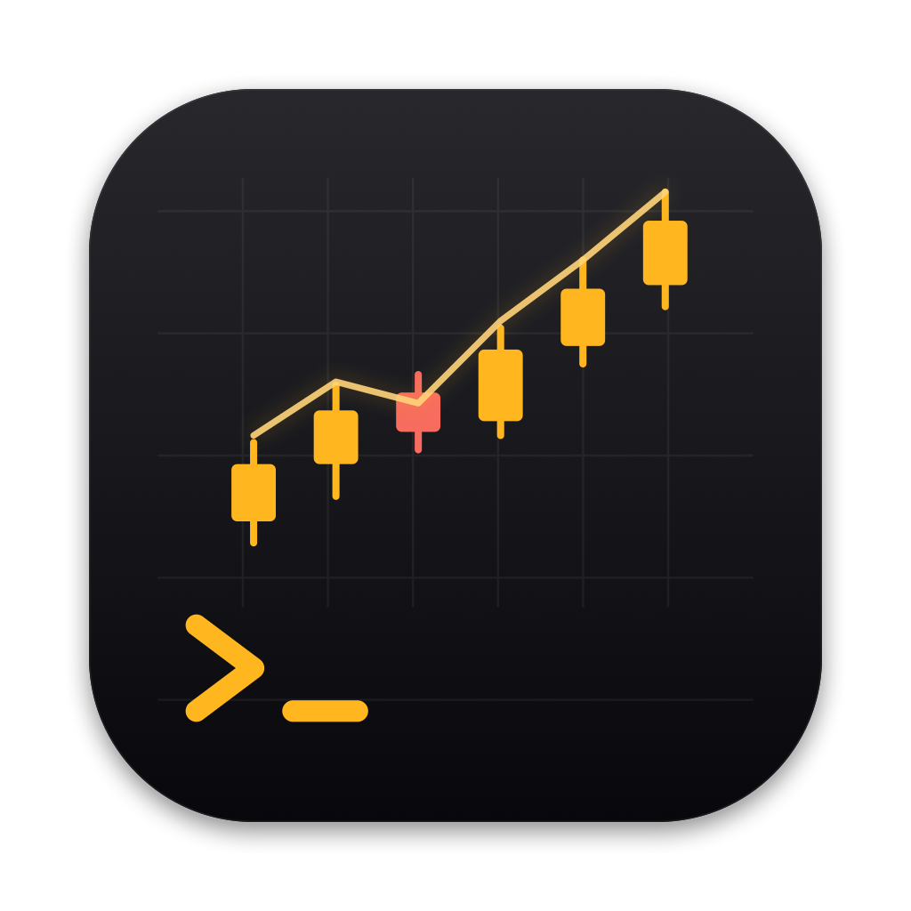
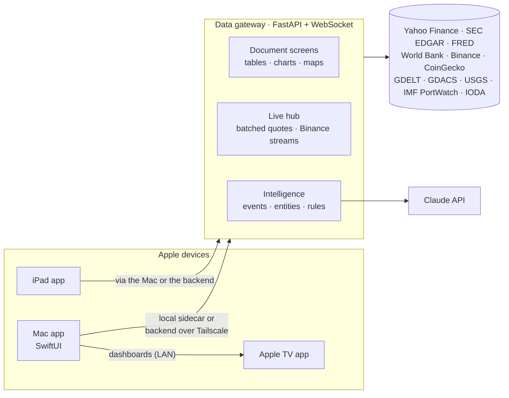

<p align="center">
  
</p>

<h1 align="center">finops-terminal</h1>

<p align="center">
  <b>A Bloomberg-style market terminal for the Mac, iPad and Apple TV — built on free data.</b><br>
  Native SwiftUI · Python data gateway · live crypto over WebSocket · world-events intelligence · Claude-powered analysis
</p>

<p align="center">
  
  
  
  
  
  
</p>

---

## What it is

A dense, dark, amber-on-black terminal in the spirit of the Bloomberg Terminal: 1, 2 or 4 linked
panels, a command line and a clickable sidebar. **Everything works both ways** — type
`AAPL US EQ CHART 5Y CANDLE SMA50` or click your way there.

The Mac app talks to a small Python gateway that aggregates free sources (Yahoo Finance, SEC EDGAR,
FRED, World Bank, Binance, GDELT, GDACS, USGS, IMF PortWatch…). The gateway runs either as a local
sidecar or on a home server reached over Tailscale; the iPad and the Apple TV use the same data.

## Highlights

| | |
|---|---|
| 📈 **Securities** | Quote with intraday and 1-year charts, TradingView-style charts with indicators and event markers, company profile, SEC financial statements with charts, estimates, holders, filings, options chains, relative value, DCF |
| 🌍 **Markets** | World markets, movers, screener, S&P 500 heatmap, currency matrix, yield curve, economy (FRED), central banks, World Bank, economic calendar, ETFs (US, **PEA** and European UCITS lists) |
| ₿ **Crypto & RWA** | Live Binance market over WebSocket (order book, trades, 15-minute candles), crypto news, tokenized real-world assets (gold, treasuries, private credit, tokenized stocks vs the real share) |
| 🛰️ **Intelligence** | World monitor map (conflicts, unrest, sanctions, disasters, shipping chokepoints, internet outages, prediction markets), entity graph (`LINK HORMUZ`), event studies, cross-source rules, investigation cases, portfolio world exposure |
| 🤖 **Claude** | `WHY` explains a move from the measured evidence; every headline is scored for sentiment and impact (Claude Sonnet) in NEWS and SENT |
| 📺 **Apple TV** | Dashboard builder on the Mac (charts, heatmaps, slideshows, ticker band, Bloomberg TV) pushed live to the TV |
| 📱 **iPad** | Keypad mode that drives the Mac like a terminal keyboard, or a full terminal on its own |

## Command line

Press **⌘L** to jump to the command line, **Esc** to leave it. Securities are typed
`<ticker> [venue] <class>`, functions follow:

```text
AAPL US EQ CHART 5Y CANDLE VOL SMA50      chart with volume and moving average
AAPL US EQ WHY                            why did it move? (evidence + Claude)
WPEA FP ETF                               iShares MSCI World Swap PEA, Euronext Paris
BTC CRYPTO                                live order book and trades from Binance
ETF PEA                                   PEA-eligible ETFs
WORLD SHIPPING                            chokepoints and maritime events on the map
LINK TAIWAN                               what Taiwan is connected to, and what is happening there
SPX IDX STUDY WHEN CL1 CMD >3             what the S&P 500 does after oil jumps 3 %
SCRN MCAP>10B PE<20 SECTOR=TECHNOLOGY     equity screener
```

Venues: `US` · `FP` Paris · `LN` London · `GY` Xetra · `NA` Amsterdam · `IM` Milan · `SM` Madrid ·
`SW` Swiss · `JP` Tokyo · `HK` · `CN` Toronto · `AU`. Classes: `EQ` `ETF` `IDX` `FX` `CMD` `CRYPTO`.
Type `HELP` in the app for every function and its arguments.

## Architecture



The gateway answers with **documents** (tables, key/value cards, charts, treemaps, matrices,
graphs, maps) that one renderer draws on every device, so a new screen is mostly Python.

| Folder | What's inside |
|---|---|
| [`app/`](app) | Swift package: `FinopsCore` (models, client, command parser), `FinopsDash` (shared rendering), `FinopsUI`, `FinopsRemote`, the Mac app |
| [`gateway/`](gateway) | Python gateway: providers, intelligence, WebSocket server, tests |
| [`ipad/`](ipad), [`tv/`](tv) | iPad and Apple TV apps (XcodeGen projects) |
| [`infra/`](infra) | Backend VM on Proxmox: provisioning, Docker Compose, deploy script, Tailscale |
| [`docs/`](docs) | [Architecture](docs/ARCHITECTURE.md), [backend plan](docs/BACKEND_PLAN.md), research notes |

## Getting started

**Requirements:** macOS 15+, Xcode 16+ (Swift 6) and [uv](https://docs.astral.sh/uv/) — uv installs
Python 3.12 and the gateway's dependencies on first launch.

```bash
cd app && ./scripts/make-app.sh && open build/finops-terminal.app
```

Or open `app/Package.swift` in Xcode and run the `FinopsTerminal` scheme. Then, in **Settings (⌘,)**:

| Setting | Why | |
|---|---|---|
| FRED API key | Economy, yield curve, central banks | free — [get one](https://fred.stlouisfed.org/docs/api/api_key.html) |
| EDGAR contact email | SEC asks automated clients to identify themselves | for financials and filings |
| Anthropic API key | `WHY` analysis and headline sentiment | optional — a word lexicon is used without it |

Keys live in the macOS Keychain behind Touch ID and are never written to the repository.

<details>
<summary><b>Backend server (optional)</b></summary>

A Proxmox VM can run the gateway for every device — see [`infra/`](infra/README.md). On the Mac:
**Settings → Backend**, enter `finops-backend.<tailnet>.ts.net` and a code from `finops-admin pair`.
The Mac uses the backend when it is reachable and falls back to its local sidecar otherwise,
reconnecting within seconds when the backend comes back.
</details>

<details>
<summary><b>iPad and Apple TV</b></summary>

```bash
cd ipad && xcodegen generate && open FinopsPad.xcodeproj
cd tv   && xcodegen generate && open FinopsTV.xcodeproj
```

Pick your team and device in Xcode, then Run. On the Mac, the iPad icon in the toolbar shows a
pairing code. Apple TV dashboards are built under **TV dashboards** on the Mac and pushed to the TV
over the local network.
</details>

## Tests

```bash
cd gateway && uv run pytest
cd app && swift test
```

## Disclaimer

Personal project. Market data comes from free and unofficial sources (notably Yahoo Finance through
`yfinance`) and may be delayed or incomplete. Nothing here is investment advice, and the terminal
never places orders.
